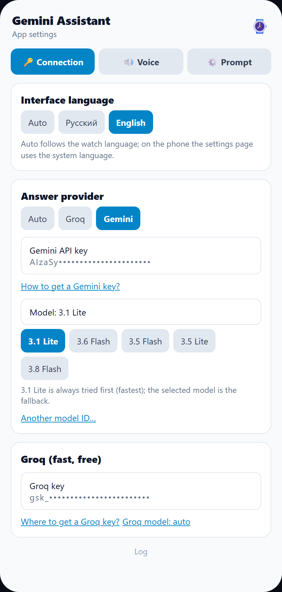
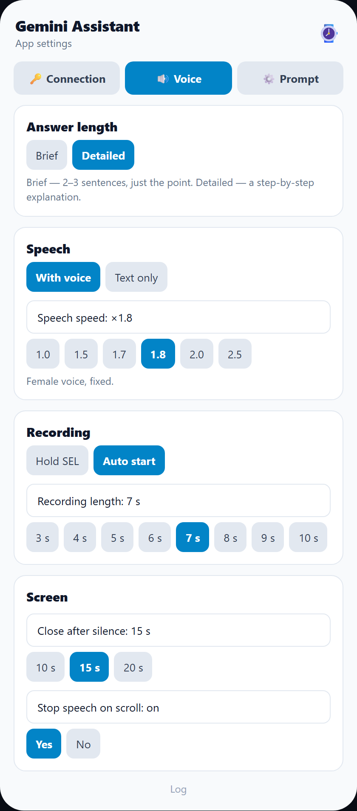

# Gemini Assistant for Amazfit T-Rex 3 Pro

A voice assistant for the Amazfit T-Rex 3 / T-Rex 3 Pro on Zepp OS 3.x: ask a question by voice, the watch shows the answer as text and reads it aloud. Powered by Google Gemini or Groq.

[Русская версия →](README.md)

---

## ⚠️ Read this first

### 1. In Russia you almost always need a VPN on the phone

The Zepp app and the assistant call `generativelanguage.googleapis.com` (Google) and `api.groq.com`. In Russia the Gemini host is usually blocked, so without a VPN there will be no answer.

Important:

- The VPN must run **on the phone**, not only in the browser.
- Use **"all apps" / full tunnel** mode so the Zepp app traffic also goes through the VPN.
- If the VPN does not route Zepp, the assistant shows "Service is unavailable" and says it aloud.

### 2. You need your own API keys

The assistant cannot send a request without a key. The keys are free, but you have to get them yourself:

| Provider | Where to get the key | What it does |
|---|---|---|
| **Google Gemini** | [aistudio.google.com/apikey](https://aistudio.google.com/apikey) | Main provider: understands audio and answers |
| **Groq** | [console.groq.com/keys](https://console.groq.com/keys) | Fast option: Whisper transcribes, Llama answers |

Paste the keys in the Zepp app settings: **Profile → Settings → Gemini Assistant → "Connection"**. The keys are stored only in the phone settings and go directly to Google/Groq.

The settings page has step-by-step links: "How to get a Gemini key?" and "Where to get a Groq key?".

---

## What the assistant can do

- 🎙️ **Voice recording on the watch** — hold SEL (push-to-talk) or auto-start with a 3–10 second recording.
- 🧠 **Two providers** — Google Gemini and Groq (Whisper + Llama). If Groq fails, the request falls back to Gemini automatically.
- 🔊 **Spoken answer** — speech is synthesised on the phone and played through the watch speaker. Long answers are split into parts and the current part is highlighted.
- 📖 **Text on screen** — swipe through the full answer; scrolling can stop the speech so you can read calmly.
- 🌐 **Russian and English** — choose the interface language in the settings or follow the watch automatically (`Auto`). English covers the settings, watch UI, model answers and voice cues.
- 🔁 **Auto cycle** — after an answer the app starts the next recording by itself (when "Auto start" is on).
- 🛡️ **Clear errors** — no internet/VPN: a short spoken hint; no phone connection: "Connection lost".
- 📋 **Log** — watch and phone logs in the settings, copyable to the clipboard. Helps to see where the delay is.

## Settings screenshots

| Connection | Voice |
|---|---|
|  |  |

## Installation

1. Download the package: **[gemini_assistant.zpk](https://ghsns.github.io/gemini_assistant.zpk)**.
2. Enable developer mode in the Zepp app: **Profile → Settings → About**, tap the Zepp logo 7 times.
3. Open **Profile → Developer mode → QR scanner**.
4. Scan the QR code on the [project page](https://ghsns.github.io/) or install the downloaded `.zpk` manually.
5. Open the app settings in Zepp and paste your API keys.

The package is built in `preview` mode — this is normal for installation through Zepp.

## How to use

- **Push-to-talk:** hold SEL, speak, release — the recording is sent.
- **Auto start:** the app records 3–10 seconds after launch and after every answer.
- **Answer:** the text appears immediately, the first part is spoken, the rest are fetched while it plays.
- **Swipe:** moves through the answer parts; swiping during speech stops the voice (configurable).
- **Closing:** the app closes itself after 10/15/20 seconds of silence.

## Language

There are three options in the settings:

- **Auto** — Russian or English, following the watch language.
- **Русский** — interface, answers and speech in Russian.
- **English** — interface, answers and speech in English.

The language affects the settings, watch UI, model system instruction, TTS voice and spoken error cues.

## Watchface

A separate project — the modified **Modular Wellness (Fix)** with three palettes and interactive taps. It has its own README:

**[Open the watchface description →](WATCHFACE.en.md)**

## Links

- Project showcase: [ghsns.github.io](https://ghsns.github.io/)
- Assistant: [gemini_assistant.zpk](https://ghsns.github.io/gemini_assistant.zpk)
- Watchface: [modular_wellness_mod.zpk](https://ghsns.github.io/modular_wellness_mod.zpk)
- Gemini key: [aistudio.google.com/apikey](https://aistudio.google.com/apikey)
- Groq key: [console.groq.com/keys](https://console.groq.com/keys)
- Original watchface: [novvember/amazfit-watchfaces](https://github.com/novvember/amazfit-watchfaces)
