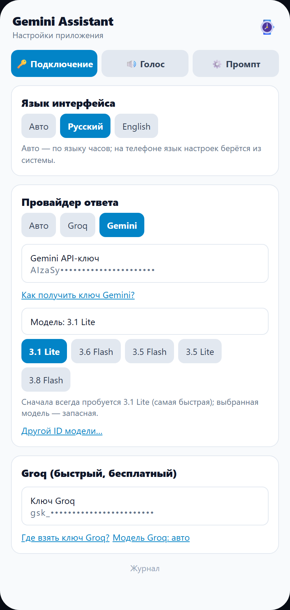
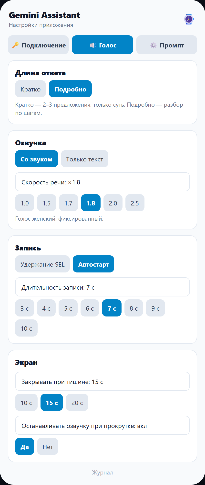

# Gemini Assistant для Amazfit T-Rex 3 Pro

Голосовой помощник для часов Amazfit T-Rex 3 / T-Rex 3 Pro на Zepp OS 3.x: вы задаёте вопрос голосом, часы показывают ответ текстом и читают его вслух. Работает через Google Gemini или Groq.

[English version →](README.en.md)

---

## ⚠️ Сначала прочитайте это

### 1. В РФ почти всегда нужен VPN на телефоне

Приложение Zepp и сам помощник обращаются к `generativelanguage.googleapis.com` (Google) и `api.groq.com`. В РФ домен Gemini обычно блокируется, поэтому без VPN ответа не будет.

Что важно:

- VPN должен быть **на телефоне**, а не только в браузере.
- Настройте VPN так, чтобы через него шёл трафик **приложения Zepp**: в большинстве VPN это «раздельное туннелирование» / выбор приложений — добавьте Zepp в список. Полный туннель тоже подойдёт, но не обязателен.
- Если VPN не пропускает Zepp, помощник покажет экран «Нет доступа к сервису» и произнесёт это голосом.

### 2. Нужны свои ключи API

Без ключей помощник не сможет отправить запрос модели. Ключи бесплатные, но получить их нужно самостоятельно:

| Провайдер | Где получить ключ | Зачем |
|---|---|---|
| **Google Gemini** | [aistudio.google.com/apikey](https://aistudio.google.com/apikey) | Основной провайдер: понимает аудио и отвечает |
| **Groq** | [console.groq.com/keys](https://console.groq.com/keys) | Быстрый вариант: Whisper распознаёт речь, Llama отвечает |

Ключи вставляются в настройках приложения Zepp: **Профиль → Настройки → раздел приложения Gemini Assistant → «Подключение»**. Ключи хранятся только в настройках на телефоне и уходят напрямую в Google/Groq.

Подробные шаги есть в самих настройках по ссылкам «Как получить ключ Gemini?» и «Где взять ключ Groq?».

---

## Что умеет помощник

- 🎙️ **Запись голоса с часов** — удержание SEL (push-to-talk) или автостарт с записью 3–10 секунд.
- 🧠 **Два провайдера** — Google Gemini и Groq (Whisper + Llama). Если Groq не ответил, запрос автоматически уходит в Gemini.
- 🔊 **Ответ голосом** — речь синтезируется на телефоне и играется в динамике часов. Длинный ответ разбивается на части, текущая часть подсвечивается на экране.
- 📖 **Текст на экране** — весь ответ листается свайпом; можно остановить озвучку прокруткой и читать спокойно.
- 🌐 **Русский и английский** — язык интерфейса выбирается в настройках или берётся с часов автоматически (`Авто`). На английском переводятся настройки, экран часов, ответы модели и голосовые подсказки.
- 🔁 **Автоцикл** — после ответа приложение само начинает следующую запись (если включён «Автостарт»).
- 🛡️ **Понятные ошибки** — нет интернета/VPN: короткая подсказка голосом; нет связи с телефоном: «Связь не установлена».

## Скриншоты настроек

| Подключение | Голос |
|---|---|
|  |  |

## Установка

Скачивать пакет необязательно — проще сразу отсканировать QR-код.

1. В приложении Zepp включите режим разработчика: **Профиль → Настройки → О программе**, нажмите 7 раз на логотип Zepp.
2. Откройте **Профиль → Режим разработчика → сканер QR-кода** и отсканируйте QR-код со [страницы проекта](https://ghsns.github.io/).
3. Если QR не подходит, скачайте [gemini_assistant.zpk](https://ghsns.github.io/gemini_assistant.zpk) и установите его через тот же режим разработчика вручную.
4. После установки откройте настройки приложения в Zepp и вставьте ключи API.

Пакет собран в режиме `preview` — это нормально для установки через Zepp.

## Как пользоваться

- **Push-to-talk:** удерживайте SEL, говорите, отпустите — запись отправится.
- **Автостарт:** приложение само пишет 3–10 секунд после запуска и после каждого ответа.
- **Ответ:** текст появляется сразу, первая часть озвучивается, следующие подгружаются по мере произнесения.
- **Свайп:** листает части ответа; если потянуть во время речи, озвучка останавливается (настраивается).
- **Закрытие:** через 10/15/20 секунд тишины приложение закрывается само.

## Язык

В настройках есть три варианта:

- **Авто** — русский или английский по языку часов.
- **Русский** — интерфейс, ответы и озвучка на русском.
- **English** — интерфейс, ответы и озвучка на английском.

Язык влияет на настройки, экран часов, системную инструкцию модели, голос TTS и голосовые подсказки ошибок.

## Циферблат

Отдельный проект — модифицированный **Modular Wellness (Fix)** с тремя палитрами и интерактивными тапами. У него свой README:

**[Открыть описание циферблата →](WATCHFACE.md)**

## Ссылки

- Витрина проектов: [ghsns.github.io](https://ghsns.github.io/)
- Приложение: [gemini_assistant.zpk](https://ghsns.github.io/gemini_assistant.zpk)
- Циферблат: [modular_wellness_mod.zpk](https://ghsns.github.io/modular_wellness_mod.zpk)
- Ключ Gemini: [aistudio.google.com/apikey](https://aistudio.google.com/apikey)
- Ключ Groq: [console.groq.com/keys](https://console.groq.com/keys)
- Исходный циферблат: [novvember/amazfit-watchfaces](https://github.com/novvember/amazfit-watchfaces)
