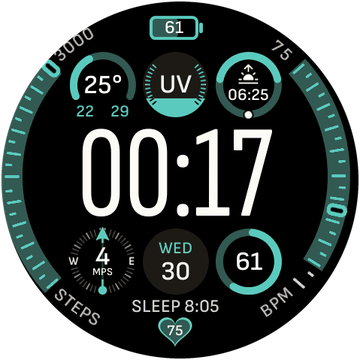
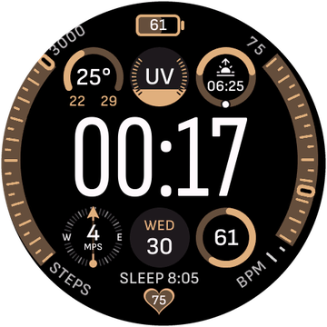

# Modular Wellness (Fix) for Amazfit T-Rex 3 Pro

A modified round watchface for Zepp OS 3.x. Based on the open **Modular Watchface** by [novvember/amazfit-watchfaces](https://github.com/novvember/amazfit-watchfaces), adapted for the T-Rex 3 Pro: fixed barometer, larger tap zones, battery hiding and tactical palettes.

[Русская версия →](WATCHFACE.md)

---

## Screenshots

| Blue | Green | Sand |
|---|---|---|
|  |  |  |

## Features

- 🕐 **Large time** in the centre with tidy progress rings around it.
- 🌤 **Weather, UV index, sunrise/sunset** in the top slots.
- 🌡 **Barometer** — `hmSensor.id.BARO`, pressure converted from hPa to mmHg.
- ❤️ **Heart rate, steps, sleep, PAI** — slots and side scales.
- 🔋 **Top battery** — hidden at ≤10% so it does not duplicate the system badge.
- 👆 **Interactive taps** — Sun and Moon open TideScreen / Sun & Moon; tap zones are enlarged for the T-Rex 3 bezel.
- 🎨 **7 two-tone Garmin-style palettes**: blue, green, sand, orange, red, yellow and monochrome.
- 🧭 **Z-Index** — buttons and taps stay above background layers, no accidental overlaps.

## Installation

1. Download the package: **[modular_wellness_mod.zpk](https://ghsns.github.io/modular_wellness_mod.zpk)**.
2. Enable developer mode in Zepp: **Profile → Settings → About**, tap the logo 7 times.
3. Open **Profile → Developer mode → QR scanner**.
4. Scan the QR code on the [project page](https://ghsns.github.io/#watchface) or install the `.zpk` manually.

## Palettes

The watchface has seven themes. The screenshots above show blue, green and sand; the rest are selected in the watchface settings on the watch.

## Changes from the original

- Fixed barometer and pressure units.
- Larger top battery zone for the T-Rex 3 bezel.
- Watchface battery hidden at ≤10%.
- Added tactical palettes and Sun/Moon taps to TideScreen.
- Fixed layer order (Z-Index) so buttons always stay on top.

## Links

- Original watchface: [novvember/amazfit-watchfaces](https://github.com/novvember/amazfit-watchfaces)
- Package: [modular_wellness_mod.zpk](https://ghsns.github.io/modular_wellness_mod.zpk)
- Project showcase: [ghsns.github.io](https://ghsns.github.io/)
- Voice assistant: [README.en.md](README.en.md)
